# 🛠️ Awesome Problem Management

<p align="center">
  
</p>

<p align="center">
  <a href="https://github.com/ishandutta2007/Awesome-Awesome-Awesome"></a><a href="https://discord.gg/jc4xtF58Ve"></a>
  <a href="https://github.com/ishandutta2007/Awesome-Problem-Management/stargazers"></a>
  <a href="https://github.com/ishandutta2007/Awesome-Problem-Management/network/members"></a>
  <a href="https://github.com/ishandutta2007/Awesome-Problem-Management/blob/main/LICENSE"></a>
  <a href="https://github.com/ishandutta2007"></a>
</p>

---

## 📌 Executive Summary & SEO Overview

**Awesome Problem Management** is an authoritative, community-curated directory indexing top enterprise **SaaS products** and **open-source GitHub software** dedicated to **ITIL 4 Problem Management**, **Root Cause Analysis (RCA)**, **Known Error Databases (KEDB)**, and **Incident Recurrence Prevention**. 

While Incident Management focuses on rapid service restoration ("firefighting"), **Problem Management** focuses on identifying underlying causes, eliminating repeating outages, establishing documented workarounds, and implementing structural change fixes. This index equips IT service managers, SREs, DevOps teams, and CTOs with transparent comparisons across company size, pricing tiers, trial limits, and architectural capabilities.

---

## 📑 Table of Contents

- [🌐 Sector Overview & Market Dynamics](#-sector-overview--market-dynamics)
- [🏢 Enterprise SaaS Platforms](#-enterprise-saas-platforms)
- [🔓 Open-Source GitHub Projects](#-open-source-github-projects)
- [🧩 Problem Management Architecture & Workflow](#-problem-management-architecture--workflow)
- [🤝 How to Contribute](#-how-to-contribute)
- [💖 Support & Community](#-support--community)
- [📈 Star History](#-star-history)
- [⚖️ Disclaimer & License](#-disclaimer--license)

---

## 🌐 Sector Overview & Market Dynamics

The global **IT Service Management (ITSM)** and **Problem Management** market is valued at approximately **$14.8B to $17.4B in 2026** (expanding from ~$13.5B in 2024 at a compound annual growth rate of **14%–16%**, on trajectory to exceed **$35B by the early 2030s**). 

The competitive landscape is **moderately fragmented**: high-end enterprise workflows exhibit consolidation around an oligopoly of mega-cap leaders (such as ServiceNow and Atlassian) capturing high-ACV global 2000 contracts, while mid-market organizations and sovereign operations drive active fragmentation among agile SaaS providers (Freshworks, HaloITSM, ManageEngine) and community-driven, self-hosted open-source stacks.

---

## 🏢 Enterprise SaaS Platforms

Below is the definitive comparison of leading SaaS Problem Management platforms, sorted in **descending order by company size** (market capitalization or valuation benchmark).

| 🏢 Platform | 📈 Company Size (Rev / Valuation) | 💵 Starting Tier Pricing | 🎁 Free Tier / Free Trial Limits | 🔍 Key Problem Management Capabilities |
| :--- | :--- | :--- | :--- | :--- |
| **[ServiceNow Problem Management](https://www.servicenow.com/)** | **~$150B Market Cap** (~$11.0B FY24 Rev) | **~$100 / user / month** (Unlocked in ITSM Advanced tier; annual contract basis) | **10-day hibernating developer instance** (Free Personal Developer Instance / PDI with full ITSM/Problem workflows, reclaimable on inactivity); or **15-day sales PoC** | Comprehensive ITIL 4 lifecycle (Assess → RCA → Fix in Progress → Resolved); multi-incident correlation, CMDB dependency mapping, automated Known Error records (KEDB), and change management handoffs. |
| **[Jira Service Management](https://www.atlassian.com/software/jira/service-management)** | **~$52B Market Cap** (~$4.4B FY24 Rev) | **$51.42 / agent / month** (Premium tier monthly; or $45/agent/mo annually; Standard at $20/mo excludes Problem Management) | **Free forever plan for up to 3 agents** (basic ticketing; excludes Problem Management); **14-day free trial** of Premium tier (up to 10 agents, extensible up to 30 days) | Group recurring incidents under problem tickets, dedicated root cause investigation queues, Post-Incident Review (PIR) automation, and Confluence-integrated workaround publishing. |
| **[ManageEngine ServiceDesk Plus](https://www.manageengine.com/products/service-desk/)** | **~$12.0B Est. Valuation** (~$1.4B Zoho Corp Rev) | **$67 / technician / month** (Enterprise Cloud Edition with native Problem & Change modules, billed annually) | **Free forever plan for up to 5 technicians** (Standard edition; excludes Problem module); **30-day free trial** of Enterprise edition (unlimited technicians and IT assets) | Zia AI clustering similar incident tickets into candidate problems, visual 5-Whys root cause workflows, CMDB blast-radius inspection, and shared Known Error repository. |
| **[Zendesk](https://www.zendesk.com/)** | **$10.2B Take-Private Valuation** (~$2.0B ARR) | **$55 / agent / month** (Suite Team billed annually; or Support Team at $19/agent/mo with problem ticket type) | **14-day free trial** with full Suite Professional capabilities unlocked (no credit card required; up to 5 agents) | Dedicated "Problem" ticket archetype linking related incident tickets, one-click bulk status and workaround propagation, automated trigger notifications, and Zendesk AI triage. |
| **[BMC Helix ITSM](https://www.bmc.com/)** | **~$10.0B Valuation** (~$2.3B Rev / KKR) | **~$100 / user / month** (ITSM Cloud standard foundation package) | **30-day guided cloud evaluation sandbox** (pre-loaded with ITIL Problem Solver workflows, sample incident clusters, and audit tools) | AI-powered **Problem Solver** proactively clustering incident patterns, timeline-based RCA, cognitive service insights, and audit-ready Post-Incident Reviews (PIR) with PDF export. |
| **[Ivanti Neurons for ITSM](https://www.ivanti.com/)** | **~$4.5B Valuation** (~$1.5B Rev / Clearlake & TA) | **~$89 / analyst / month** (ITSM Enterprise Named Analyst subscription, billed annually) | **30-day sales-guided proof-of-concept trial** (dedicated cloud tenant with unlimited analyst workflows and CMDB integration) | Proactive endpoint anomaly correlation, structured problem investigation workspaces, automated knowledge base synchronization for workarounds, and voice-to-ticket AI diagnostics. |
| **[Cherwell Service Management](https://www.cherwell.com/)** | **~$4.5B Parent Valuation** (~$1.5B Ivanti Rev) | **~$89 / concurrent user / month** (Annual enterprise contract through Ivanti licensing) | **30-day sales-engineered staging sandbox** (access to complete codeless workflow designer, CMDB, and problem lifecycle templates) | Codeless visual workflow designer, Quick Info Tile showing incident threshold alerts, Known Error portal publishing, and automated remediation task assignments. |
| **[Freshservice](https://www.freshworks.com/freshservice/)** | **~$3.9B Market Cap** (~$903M TTM Rev) | **$99 / agent / month** (Pro tier billed annually, or $119/mo monthly; Problem Management unlocked at Pro tier) | **14-day free trial** with full Enterprise tier capabilities unlocked including Problem Management (no credit card required; up to 5 agents) | ITIL-aligned problem lifecycle, timeline-driven root cause tracking, two-way incident-to-problem synchronization, service catalog change handoffs, and Freddy AI insights. |
| **[SysAid](https://www.sysaid.com/)** | **~$280M Valuation** (~$45M ARR) | **$89 / agent / month** (Professional tier with SysAid Copilot and core Problem Management, billed annually) | **14-day free trial** with up to 5 administrator seats and full AI / problem tracking workflows (no credit card required) | SysAid Copilot recommending probable root causes from historical resolution data, CMDB asset blast-radius detection, proactive recurrence prediction, and automated workaround routing. |
| **[HaloITSM](https://www.haloitsm.com/)** | **~$150M Valuation** (~$35M ARR) | **$79 / agent / month** (All-inclusive plan with complete Problem Management & ITIL suite, billed annually; min 3 agents) | **30-day free trial** with 100% of platform modules and features completely unlocked (no credit card required; unlimited agents) | All-inclusive transparent ITIL platform, smart-link escalation from incident to problem, single-click mass incident updates upon problem fix, and integrated public/internal KEDB publication. |

---

## 🔓 Open-Source GitHub Projects

Self-hosted, sovereign, and community-driven tools for organizations demanding data privacy, on-premise governance, and no per-agent licensing fees. Repositories are ranked in **descending order by GitHub star count**.

| 📦 Repository & Stargazers | ⭐ Star Badge | 📜 License | 🎯 Problem Management Focus |
| :--- | :---: | :---: | :--- |
| **[Keep](https://github.com/keephq/keep)** | <a href="https://github.com/keephq/keep/stargazers"></a> | Apache-2.0 | **AIOps & Alert Correlation Engine**: Modern open-source platform that automatically aggregates, deduplicates, and correlates alerts across monitoring tools into root-cause problem candidates with automated workflow orchestration. |
| **[GLPI](https://github.com/glpi-project/glpi)** | <a href="https://github.com/glpi-project/glpi/stargazers"></a> | GPL-3.0 | **Comprehensive ITIL Service Desk & CMDB**: Features a full native ITIL Problem Management module enabling teams to link multiple incident tickets to a single problem, calculate business impact via CMDB assets, and document Known Error solutions. |
| **[Dispatch](https://github.com/Netflix/dispatch)** | <a href="https://github.com/Netflix/dispatch/stargazers"></a> | Apache-2.0 | **Netflix Incident & Crisis Management**: Coordinates operational incidents and drives post-incident reviews (PIR), blameless post-mortem analysis, root-cause categorization, and tracking of permanent corrective action items. |
| **[Zammad](https://github.com/zammad/zammad)** | <a href="https://github.com/zammad/zammad/stargazers"></a> | AGPL-3.0 | **Enterprise Web Helpdesk**: Modular ticketing platform supporting custom problem ticket object attributes, master-slave ticket linking (grouping incidents under master problems), SLA escalation, and internal knowledge base workarounds. |
| **[FreeScout](https://github.com/freescout-help-desk/freescout)** | <a href="https://github.com/freescout-help-desk/freescout/stargazers"></a> | AGPL-3.0 | **Lightweight PHP/Laravel Helpdesk**: Self-hosted support solution with modules for internal collision detection, ticket merging, canned response workarounds, and SLA tracking for small engineering teams tracking recurring service defects. |
| **[osTicket](https://github.com/osTicket/osTicket)** | <a href="https://github.com/osTicket/osTicket/stargazers"></a> | GPL-2.0 | **Battle-Tested Support Portal**: Configurable help topics for problem intake, ticket thread linking, inter-departmental task assignment, and an integrated internal knowledge base (FAQ) for workaround dissemination. |
| **[Frappe Helpdesk](https://github.com/frappe/helpdesk)** | <a href="https://github.com/frappe/helpdesk/stargazers"></a> | GPL-3.0 | **Modern Python/Vue Helpdesk**: Extensible ticket management built on Frappe Framework; custom DocTypes facilitate problem record creation, SLA triggers, and integration with ERPNext CMDB and knowledge bases. |
| **[Helpy](https://github.com/helpyio/helpy)** | <a href="https://github.com/helpyio/helpy/stargazers"></a> | MIT | **Ruby on Rails Support Suite**: Clean open-source helpdesk featuring multi-lingual knowledge base publishing, ticket assignment, and community forums that serve as public or private Known Error repositories. |
| **[Faveo Helpdesk](https://github.com/faveosuite/faveo-helpdesk)** | <a href="https://github.com/faveosuite/faveo-helpdesk/stargazers"></a> | Community Edition | **Automated Helpdesk Engine**: Web-based ticketing system equipped with workflow automation rules, priority escalations, and knowledge base modules suitable for recurring problem classification. |
| **[iTop](https://github.com/Combodo/iTop)** | <a href="https://github.com/Combodo/iTop/stargazers"></a> | AGPL-3.0 | **ITIL-Certified ITSM & CMDB**: Designed specifically for ITIL compliance with a native Problem Management module directly connected to a robust CMDB; tracks root causes, Known Errors, workaround docs, and change requests. |
| **[Morgue](https://github.com/etsy/morgue)** | <a href="https://github.com/etsy/morgue/stargazers"></a> | Apache-2.0 | **Etsy Post-Mortem & RCA Tracker**: Purpose-built application for conducting blameless engineering post-mortems, logging chronological incident timelines, capturing IRC/Slack chats, and tracking permanent remediation tasks. |
| **[Znuny](https://github.com/znuny/Znuny)** | <a href="https://github.com/znuny/Znuny/stargazers"></a> | GPL-3.0 | **Enterprise Service Management (OTRS Fork)**: Established open-source ITIL platform with ticket-type configuration for problem tracking, parent-child incident escalation, and FAQ-based Known Error Database (KEDB) management. |
| **[heidsoft ITSM](https://github.com/heidsoft/itsm)** | <a href="https://github.com/heidsoft/itsm/stargazers"></a> | Apache-2.0 | **AI-Native Go & Next.js ITSM**: Implements an end-to-end ITIL flow: Recurring Incidents → Problem Investigation → Known Error Recording → Knowledge Publication → RAG-powered automated workaround retrieval. |

---

## 🧩 Problem Management Architecture & Workflow

```mermaid
flowchart LR
    A["🚨 Multiple Incidents"] -->|Cluster & Detect| B["🔬 Problem Record"]
    B -->|Structured RCA: 5-Whys| C["🔍 Root Cause Identified"]
    C -->|Document Temporary Fix| D["📖 Known Error Database (KEDB)"]
    D -->|Workaround Shared| E["⚡ Faster Incident Recovery"]
    C -->|Request for Change (RFC)| F["🛡️ Permanent Resolution"]
    F -->|Deploy Fix| G["🎉 Zero Recurrence"]
```

### 🎯 Key Phases in the ITIL Problem Management Lifecycle

1. **Problem Detection & Logging**: Proactive pattern identification (via AI anomaly clustering or incident frequency thresholds) or reactive logging following a Major Incident.
2. **Problem Categorization & Prioritization**: Ranking problems based on business criticality, user blast radius, and potential financial impact.
3. **Investigation & Diagnosis (RCA)**: Applying structured analytical methods:
   - **5 Whys Analysis**: Iterative interrogative technique to drill down to foundational defects.
   - **Ishikawa (Fishbone) Diagrams**: Grouping potential causal factors across People, Process, Technology, and Environment.
   - **Fault Tree Analysis (FTA)**: Deductive failure analysis modeling pathways leading to system failures.
4. **Workaround Identification & KEDB Entry**: Immediate documentation of temporary relief measures in the Known Error Database to reduce Mean Time to Resolution (MTTR) while a permanent fix is engineered.
5. **Permanent Fix & Change Coordination**: Submitting a Request for Change (RFC) to the Change Enablement practice to deploy code patches, infrastructure updates, or architectural overhauls.
6. **Post-Mortem & Closure**: Confirming that recurring incidents have ceased and documenting learnings.

---

## 🤝 How to Contribute

We welcome additions, corrections, and architectural guides from the community!

1. **Fork the repository** to your GitHub account.
2. **Create a branch** for your feature or update:
   ```bash
   git checkout -b feature/add-new-tool
   ```
3. **Add your entry** to either the SaaS or Open-Source table, maintaining alphabetical order or star/size ranking criteria.
   - For SaaS: Include specific starting tier pricing, explicit free trial limits, and verified company valuation/revenue metrics.
   - For Open-Source: Include the shields.io social star badge linked to the repo stargazers page, license, and problem management capabilities.
4. **Test your markdown** for clean rendering.
5. **Submit a Pull Request** with a concise summary of the addition.

---

## 💖 Support & Community

Thank you for exploring **Awesome Problem Management**! This project is maintained to foster open, transparent, and resilient IT service engineering practices worldwide.

If this directory saved you hours of procurement research or helped your team eliminate recurring outages:
- ⭐ **Star this repository** to help others discover it.
- 🍴 **Fork it** to customize it for your internal team's ITIL evaluation.
- 📢 **Share it** on LinkedIn, X/Twitter, or Reddit.
- ☕ **Support the maintainer**: Buy a coffee or sponsor development via the [GitHub Sponsor Dashboard](https://github.com/sponsors/ishandutta2007).

---

## 📈 Star History

[](https://star-history.dera.page/#ishandutta2007/Awesome-Problem-Management&type=date&legend=top-left)

---

## ⚖️ Disclaimer & License

- **Disclaimer**: This compilation is community-curated for informational and comparative purposes. Product names, logos, valuations, and trademarks belong to their respective owners. Pricing and free-tier boundaries are subject to change by vendors.
- **License**: Distributed under the **MIT License**. See [`LICENSE`](./LICENSE) for full details.
